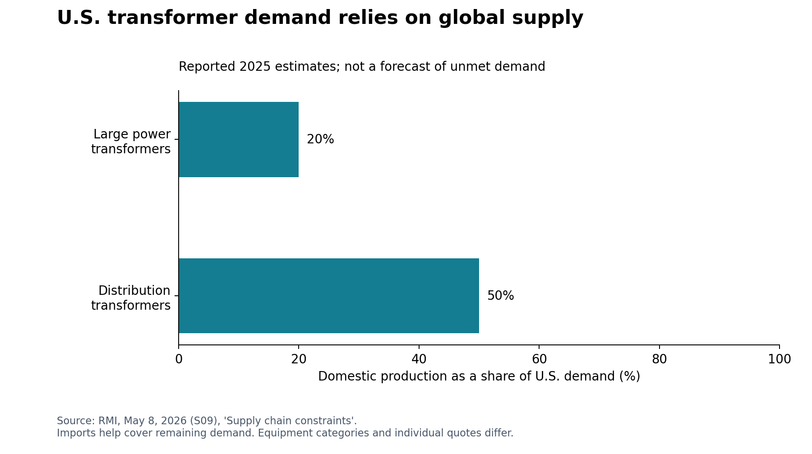
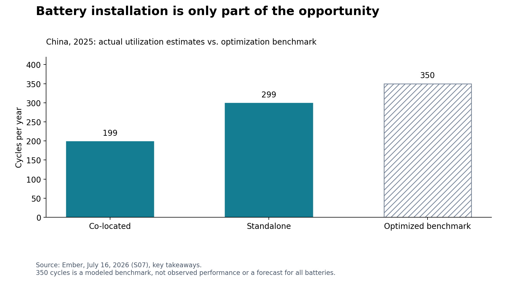

# Energy supply chain outlook: the next 12 months

**Research cutoff:** October 23, 2026. **Decision window:** October 23, 2026–October 23, 2027. **Audience:** U.S. companies buying energy, operating energy-intensive facilities, or sourcing equipment and materials through global supply chains.

## Executive assessment

**Secure deliverable power and equipment early, retain flexibility on fuel prices, and verify upstream sourcing before committing to renewable or battery projects.** Lower commodity or factory-gate prices do not necessarily translate into lower delivered costs or a project that can be energized on time.

The evidence supports four immediate priorities:

1. **Budget electricity by site and contract.** EIA forecasts a modest decline in average wholesale power prices in 2027, alongside sharply different regional outcomes. Grid investment and capacity charges can still affect bills. There is no defensible single percentage increase for all U.S. companies. [A01]
2. **Treat grid equipment and connection availability as project gates.** RMI reports large power transformer waits of up to four years and limited domestic coverage of demand. New manufacturing announcements will not remove every constraint within this report’s horizon. [S09]
3. **Separate solar and battery purchase opportunities from compliance and operating risks.** Global module and battery-pack prices have fallen, but U.S. delivered economics depend on tariffs, tax eligibility, interconnection, commissioning, and dispatch rights. [A20] [A06] [A09] [A10]
4. **Protect diesel-intensive operations against a prolonged disruption.** October IEA reporting finds strained distillate markets and exceptionally expensive tanker transport. EIA’s forecast of cheaper oil in 2027 depends on recovering Middle East flows; it is a scenario, not an assured purchasing outcome. [A03] [A04] [A05]

**Established trend** below means observed historical evidence or a documented rule/guidance provision. **Outlook** means a source forecast or this report’s conditional inference. Confidence is qualitative, not a calibrated probability: **high** indicates strong evidence for the stated observation or mechanism; **medium** indicates a plausible direction with meaningful implementation uncertainty; **low** indicates a contingent event or insufficient basis to choose a direction. Confidence in an observed trend is separate from confidence in its next-year effect.

## 1. Demand and electricity prices: growth persists, but geography determines exposure

**Established.** Ember’s April review reports global electricity demand grew **2.8% (+849 TWh) in 2025**, with China accounting for 59% of the increase. Its U.S. estimate is **3.0% (+131 TWh)**. These are historical results, not next-year forecasts. [S03] [S04]

**Latest forecast.** EIA’s October 6 outlook forecasts U.S. commercial electricity demand growth of **2.8% in 2027** and industrial growth of **2.7%**, with residential consumption approximately flat. Across its 11 tracked hubs, EIA forecasts wholesale prices averaging **$52/MWh in 2026** and **$49/MWh in 2027**. Its 2026 regional changes range from **+41% in PJM** to **−23% at Mid-Columbia**; for 2027 it forecasts declines in the expensive northeastern markets but a **19% increase to $30/MWh in CAISO**. These are source forecasts, not realized full-year prices. [A01]

*Figure 1. Selected EIA 2026-versus-2025 wholesale price forecasts, released October 6, 2026. The U.S. figure is EIA’s tracked-hub average; these percentages are not commercial retail bill changes.*

**Next 12 months.** Continued demand growth is likely to keep local connection capacity valuable even if average energy prices ease. Factory expansions, warehouses, and data centers may face connection delays or higher non-energy charges. Suppliers in energy-intensive industries can transmit these costs through component prices. Global buyers should compare local delivered electricity and reliability, rather than use U.S. gas prices as a proxy for European or Asian energy costs.

**Procurement.** Obtain each facility’s interval load, tariff, capacity and transmission pass-through terms, renewal dates, and unhedged volumes. Compare staged fixed-price purchases with indexed supply under company-approved limits. Match a power purchase agreement (PPA) to the delivery location and operating hours; a financial PPA can leave congestion, timing, and volume exposure. Prioritize demand flexibility where operationally feasible. **Confidence:** high in the historical demand trend and regional differentiation; medium in the direction of 2027 prices and local cost pressure. [S01] [S02] [A01]

## 2. Grid capacity and equipment: delivery risk can exceed purchase-price risk

**Established.** RMI’s May analysis reports waits of **up to four years** for large power transformers, domestic production covering about **20% of U.S. large power transformer demand** and **50% of distribution transformer demand in 2025**, and approximately **75% higher power transformer prices since 2019**. These are RMI’s reported estimates, not a current quote for every specification. It identifies specialized steel, copper, labor, bespoke designs, and supplier qualification as constraints. [S09]

*Figure 2. RMI’s reported 2025 domestic production coverage of U.S. demand. The unfilled portion does not mean demand went unmet; imports help supply the market. This is not a forecast of future import shares.*

**Next 12 months.** Expect uneven availability rather than a universal equipment shortage. An additional generation project does not guarantee delivery to a particular plant. U.S. reshoring projects compete with utilities, renewable developers, and other large loads for transformers, switchgear, cable, engineers, and construction crews. International suppliers can gain orders, but U.S. buyers remain exposed to upstream materials and transport. RMI expects equipment gaps to persist into 2030; that is a modeled outlook, not proof of a specific delivery delay. [S09] [S02]

**Procurement.** Before site commitment or final investment approval, require a utility connection plan, dated equipment quotations, manufacturing-slot confirmation, and a commissioning schedule. Standardize engineering specifications where safe; qualify alternate factories and service providers early. Use milestone-linked payments, inspection rights, documented substitutions, and realistic remedies. Evaluate refurbished equipment only after engineering and utility approval. Inventory critical spares according to outage loss and replacement time, not a blanket stock target.

**Opportunity.** Existing-factory expansion, repair, testing, standard components, qualified allied-country supply, and solutions that use existing grid capacity more effectively can address near-term demand faster than an unbuilt greenfield factory. **Confidence:** high in the constraint mechanism; medium in the reported market-wide estimates and persistence at any individual facility. [S09]

## 3. Renewables: strong generation growth, uneven delivered-cost benefits

**Established.** Ember reports solar generation grew **636 TWh in 2025**, equivalent to about **75% of global electricity demand growth**, while wind added **205 TWh**. Renewables supplied **33.8%** of global electricity and overtook coal; global fossil generation fell **0.2%**. These annual balances do not demonstrate that every hourly increment was met with renewables. [S03] [S04]

The supplied January U.S. solar article reports **83 TWh** of solar growth against **135 TWh** of demand growth, or **61%**. The later April review reports **85 TWh** against **131 TWh**, or **65%**. This report uses the April snapshot for annual comparisons. The two publications have different vintages; their precise revisions and coverage have not been fully reconciled. **Neither percentage is solar’s share of total U.S. electricity.** [S05] [S03]

IEA’s March technology report says global solar-module prices fell about **50% since 2023** and battery-pack prices about **30%**, while explaining that U.S. tariffs and domestic production economics affected delivered costs. Its 2025 estimates use a November 2025 policy cutoff; they are not an October 2026 tariff schedule. Separately, EIA’s October 16 rooftop-solar article confirms a growing installed base but slowing growth rates since 2022. [A20] [A12]

**Next 12 months.** Renewable procurement remains an opportunity to reduce fuel exposure, but the bottleneck can migrate from equipment to grid connection, installation, finance, or tax documentation. Global factory capacity may support competitive bids while U.S. eligibility rules narrow the acceptable supplier pool. Wind castings, bearings, and EPC capacity need separate category analysis; cheap solar modules do not establish falling costs across all energy equipment. [S02] [A20]

**Procurement.** Compare total delivered and commissioned cost, including duties, tax assumptions, financing, curtailment, warranties, and service. Request bids with and without assumed credits. Require the developer to identify connection milestones, curtailment allocation, delay protections, and the physical source of critical components. Use modular on-site projects where tariffs and facility economics justify them. **Confidence:** high in historical renewable growth; medium in near-term purchasing opportunities; low in any universal price decline for U.S. installed projects.

## 4. Batteries: usable flexibility matters more than nameplate capacity

**Established.** Ember’s July China analysis finds standalone batteries cycled **299 times in 2025**, compared with **199 cycles** for renewable-co-located batteries. Its modeled **350-cycle** benchmark would unlock more shifting from existing assets, but is not actual utilization. Its August global analysis reports that solar plus batteries met more than a quarter of California’s evening demand during 7–9 p.m. on the average day in H1 2026. That regional result cannot be extrapolated to all U.S. grids. [S07] [S06]

*Figure 3. Ember’s 2025 utilization estimates for Chinese battery systems. The hatched 350-cycle bar is an optimization benchmark, not observed output or a forecast.*

**Outlook.** Ember estimates expected 2026 battery additions could shift **34% of new daily solar generation** into non-sunny hours. This is a **theoretical ceiling**, conditional on deployment and use; it is neither 34% of all solar nor a measured evening contribution. Its April and August publications also contain different global 2025 storage-deployment estimates; they are not spliced into a growth series here. [S04] [S06]

**Next 12 months.** Storage can improve peak management and solar utilization, creating demand for integration, controls, inverters, thermal management, and maintenance. It does not by itself guarantee multi-day backup, profitable arbitrage, or grid-independent operation. China’s market reforms illustrate why a large installed fleet can still be underused. [S06] [S07]

**Procurement.** Tender usable MWh, deliverable MW, efficiency, degradation, warranted throughput, augmentation, dispatch permissions, and full lifecycle service. Model revenues against local rules and avoid double counting simultaneous energy, ancillary-service, and capacity commitments. Specify fire-safety approvals, insurance, firmware access, cyber controls, spare parts, and warranty counterparties. Confirm that any resilience design can actually island and sustain the required loads. **Confidence:** high in the importance of integration and utilization; medium in achievable site-level savings; low in universal battery returns or continuous solar-only supply.

## 5. Critical minerals and geopolitics: concentration is a production risk, not just a price risk

**Established.** IEA’s **July 16, 2026** minerals outlook reports renewed price pressure in 2025–early 2026, stronger refining concentration, and expanding export restrictions. Excluding rare earths, the average top refining-country share rose to **72% in 2025**, from **70% in 2023**. China dominates most assessed refining chains; Indonesia is the major exception for nickel. The report identifies DRC cobalt quotas and restrictions involving lithium and graphite in other producing countries. [A14] [A19]

Importantly, the newer minerals outlook reports that lithium prices more than doubled and cobalt rose around 130% over its described recovery period. This qualifies older generalizations about cheap battery inputs. A falling finished-pack price over an earlier period and a subsequent mineral-price rebound can coexist. Do not treat the IEA’s live topic-page discussion of earlier oversupply as fresher evidence than its dated July report. [A19] [A20] [A17]

**Time-sensitive uncertainty.** The July report says expanded Chinese rare-earth export measures announced in October 2025 were suspended until **November 2026**. This identifies an immediate watch date; it does **not** establish that controls will automatically return unchanged or that no subsequent arrangement exists. Confirm the operative rules and license treatment when ordering. [A19]

**Next 12 months.** Export licenses, customs documentation, processing capacity, and customer qualification can disrupt motors, transformers, wind equipment, batteries, electronics, and industrial production even without an across-the-board mineral shortage. A non-Chinese final assembler may share the same Chinese refining or magnet source as another bidder. The Middle East shock also affects mineral processing: IEA links sulphur and sulphuric-acid disruption to increased processing costs. New mining announcements offer limited immediate protection if refining and qualification remain concentrated. [A19]

**Procurement.** Map mine-to-refiner-to-active-material-to-component exposure for critical inputs. Verify factory locations, ownership and control, export permissions, and the bill of materials; two distributors are not necessarily two independent sources. Qualify alternatives and substitution designs before disruption. LFP can reduce nickel and cobalt dependence but does not remove lithium, graphite, copper, or policy exposure. Use selective buffer stocks for small, essential, hard-to-substitute components and assess recycling and scrap recovery where qualified supply exists. **Confidence:** high in concentration and the disruption mechanism; medium in next-year disruption exposure; low in the timing or severity of a specific future control.

## 6. Oil, diesel, and shipping: easing is conditional, logistics remain a first-order risk

**Established.** The supplied April Ember essay describes the Hormuz shock and advocates accelerated electrification. It is an argued transition thesis, not an October shipping-status report. More recent EIA and IEA reporting confirms continuing Middle East disruption and strained product markets. EIA estimates September Brent averaged **$114/barrel** and East Coast distillate inventories were **32% below** their five-year seasonal average. IEA’s October 21 analysis reports Middle East Gulf-to-Asia crude freight exceeding **$37/barrel** by mid-October. That is an exceptional tanker-route cost, not a surcharge to apply to all ocean freight. [S08] [A03] [D01] [A04]

**Source forecasts.** EIA expects Brent to average **$105/barrel in Q4 2026**, easing to an annual **$84 in 2027**, as production and flows recover. IEA’s October 14 report warns distillate tightness can persist into 2027, with lost gasoil inventories unlikely to be replenished before H2 2027 outside normal seasonal fluctuations. Different publication dates, assumptions, products, and physical-market measures explain why these should not be collapsed into a single forecast. [A03] [A05]

*Figure 4. EIA October 2026 annual benchmark series. 2025 is historical; 2026 and 2027 are forecasts. Full-year 2027 extends beyond this report’s October 23 horizon and is shown as context, not an exact forward-12-month average. Axes use different units.*

**Next 12 months.** Trucking, construction, agriculture, backup generation, and industrial suppliers face diesel and fuel-surcharge risk. Asian refiners and import-dependent suppliers face particularly difficult delivered-cost conditions; U.S. production does not insulate U.S. buyers from internationally priced products. Refiners, maintenance providers, and some U.S. exporters can benefit, while downstream buyers face higher working-capital and delivery exposure. [A03] [A04] [A05]

**Procurement.** Separate crude-price exposure from diesel refining margins, transport, and basis. Use transparent surcharge indices, reset dates, and audit rights. Validate alternative terminals and carriers, route exposure, insurance and exclusions, inventory location, and supplier business-continuity plans. Hedge according to actual consumption and policy limits rather than assuming EIA’s price decline will occur. Electrify suitable duty cycles where power and equipment are available; broad fossil-demand collapse within 12 months is not an established finding. **Confidence:** high in current logistics stress; medium in persistent volatility; low in the precise timing of normalization.

## 7. Natural gas and LNG: export growth does not guarantee rising U.S. gas prices

**Latest forecast.** EIA projects U.S. LNG exports rising from **17.6 Bcf/day in 2026** to **18.6 Bcf/day in 2027**, yet Henry Hub falling from **$3.48/MMBtu** to **$3.16/MMBtu**, as production growth and inventories offset demand. It projects end-October inventories 2% above their five-year average. These are conditional forecasts, including a near-normal-weather assumption; prolonged cold can change the balance. [A02]

**Next 12 months.** U.S. gas-consuming manufacturers may benefit from supply growth, but regional pipeline constraints and winter basis spikes can overwhelm a benign national benchmark. LNG-importing overseas suppliers have different shipping, contract, and security exposure. Demand for gas equipment and services remains an opportunity, but it should not justify assuming every LNG project, turbine, or pipeline will arrive on schedule. [A02] [S01] [S02]

**Procurement.** Quote the delivered gas basis and firm transport separately from Henry Hub. Review interruptible-service provisions and backup-fuel availability. Assess overseas suppliers’ energy contracts rather than extrapolating U.S. gas economics. **Confidence:** high in the distinction between benchmark and delivered gas; medium in the production-buffer mechanism; low-to-medium in the exact price path.

## 8. U.S. policy: eligibility and project evidence belong in sourcing decisions

**Documented provisions.** IRS Notice 2025-42 explains that the wind/solar credit termination date of **December 31, 2027** applies to relevant facilities beginning construction **after July 4, 2026**. It generally restricts use of the 5% safe harbor for this purpose, with exceptions detailed in the notice. The construction deadline is already past as of this report; it is not a future procurement opportunity. Storage has distinct treatment and should not automatically be assigned wind/solar’s termination rule. [A09]

IRS’s February 12, 2026 announcement and Notice 2026-15 address prohibited-foreign-entity (PFE) and material-assistance restrictions for **45Y, 48E, and 45X**, including interim safe harbors, cost ratios, and substantiation. An inexpensive component can therefore impair project economics if it makes a credit assumption invalid. The announcement explicitly anticipates additional guidance; the latest applicable tables and reliance rules must be rechecked for the transaction. [A06] [A10]

**Next 12 months.** Projects dependent on late-2027 commissioning can compete for equipment and crews during this report’s horizon, and supplier-origin evidence can become a financing or acceptance condition. Domestic assembly can help resilience but does not alone establish tax eligibility or independent upstream supply. Tariffs can change landed costs, but this report does not certify any current product-specific rate, exemption, customs outcome, or pending litigation result. [S01] [S02] [A20] [A09] [A10]

**Procurement.** Require legal/tax review of applicable credit and construction status; retain physical-work and continuity evidence where relevant. Obtain component-level origin and cost records, ownership/control representations, supplier certifications, audit rights, and remedies for inaccurate documentation. Distinguish domestic-content requirements from PFE tests and ordinary customs origin. Price a no-credit or delayed-credit case. **Confidence:** high in the cited notices’ content; medium in resulting schedule and documentation pressure; low in future rule changes. This is a commercial assessment, not a legal eligibility opinion.

## 9. Prioritized sourcing and operating plan

The priorities below are analyst recommendations derived from the evidence above; they are not survey results or universal inventory rules.

| Timing | Owner | Action and output | Decision criterion | Evidence |
|---|---|---|---|---|
| First 30 days | Procurement + finance + facilities | Build a site-level energy and critical-equipment exposure map; identify contract renewals and interruption losses | Rank exposure by operational loss, unhedged cost, and replacement time | [A01] [A02] [S09] |
| First 30 days | Projects + utility liaison | Verify energization, connection milestones, and long-lead factory slots before capital commitments | Written utility and supplier evidence, not a generation announcement | [S09] [S02] |
| First 30 days | Logistics + operations | Audit diesel surcharges, terminal alternatives, insurance, and backup-fuel plans | Ability to sustain critical operations through a supplier interruption | [A04] [A05] |
| Days 30–90 | Category managers + engineering | Qualify alternative factories and upstream inputs; standardize specifications | Demonstrable upstream independence and acceptable technical performance | [A19] [S09] |
| Days 30–90 | Tax/legal + procurement | Recheck project credits, PFE rules, current tariff treatment, and supplier certifications | Documented eligibility and an acceptable no-credit case | [A06] [A09] [A10] |
| Days 30–90 | Energy team | Tender efficiency, flexible load, solar and storage against actual tariffs | Credible operating savings without double-counted revenues | [S06] [S07] [A01] |
| Quarterly through October 2027 | Finance + procurement | Refresh scenarios and rebid where supply is competitive | Stay within approved cost-at-risk and service-continuity limits | [A01] [A02] [A03] [A19] |

For financial screening, calculate **unhedged MWh × change in delivered $/MWh**, **unhedged MMBtu × change in delivered $/MMBtu**, and **unhedged gallons × change in delivered $/gallon**. Add capacity, demand, transport, duty, and tax-credit changes separately. Do not add a diesel index move twice through both fuel purchases and a carrier surcharge. The [exposure template](../data/company_exposure_template.csv) leaves company inputs blank; no company-specific saving is asserted.

## 10. Scenarios and monitoring triggers

These are **conditional analyst scenarios**, without assigned probabilities or invented price targets.

| Scenario | What would establish it | Expected supply-chain effect within the horizon | Procurement response |
|---|---|---|---|
| Gradual recovery with persistent grid constraints | More reliable Gulf flows, rebuilding product inventories, stable export licenses; grid delivery schedules remain extended | Fuel costs ease unevenly, while equipment and connection delays persist | Preserve index exposure within limits; retain critical slots and supplier qualifications |
| Renewed fuel or mineral disruption | New route attacks, lower diesel stocks, license denials, or renewed/expanded export controls | Higher delivered fuel and component costs, supplier interruptions, more cash tied in transit | Activate alternate carriers and sources; selective stock buffers; apply agreed escalation and allocation clauses |
| Softer demand and more competitive equipment supply | Load growth or committed projects fall short of plans; more qualified manufacturing capacity actually starts shipping | Better buying leverage in selected categories, weaker suppliers and warranty risk | Rebid competitive categories; avoid unnecessary take-or-pay exposure; assess counterparty health |

| Watch item | Cadence | Trigger for review | Source family |
|---|---|---|---|
| EIA electricity, gas and oil forecasts | Monthly; next release listed as November 10, 2026 | Changed production, weather, price or inventory assumptions | [D01] [A01] [A02] [A03] |
| Diesel inventories, freight and insurance | Weekly during disruption | Worsening supply cover, repeated late cargoes, surcharge changes | [A04] [A05] |
| Facility power and equipment milestones | Monthly, and before each capital gate | Utility date slips, unconfirmed factory slot, failed acceptance test | [S09] |
| Mineral controls and licenses | Before each critical order; immediate focus on November 2026 | New notices, changed license treatment, confirmation of any suspension extension | [A19] |
| Tax guidance, trade treatment and eligibility | At bid, contract, substitution and commissioning | New guidance/tables, changed bill of materials, supplier ownership or schedule | [A06] [A09] [A10] |
| Battery economics and utilization | Quarterly | Actual tariff, cycling, degradation or market participation differs from bid assumptions | [S06] [S07] |

## Evidence quality and limits

All nine supplied sources were accessed; the global-review PDF’s relevant findings and methodology were checked. Ember and RMI provide detailed analysis but advocate an energy-transition perspective. RSM and INVERTO provide useful commercial context, with some numerical claims relying on external analyses. The six Ember inputs are one publisher family; the PDF and its web chapter are the same study, not independent corroboration. EIA and IEA supply the principal additional dated market evidence, while IRS notices supply primary policy evidence.

The newest substantive source used is IEA’s **October 21, 2026** freight analysis. EIA’s October outlook was finalized **October 1** and explicitly excludes later events; its annual forecasts cannot capture every subsequent shock. IEA’s technology report contains a November 2025 cutoff for some trade estimates, while the July minerals report is fresher for mineral-market conditions. No exact site tariff, supplier quote, current customs classification, or company exposure was available. USGS’s publication record was accessible, but its report PDF returned HTTP 403; no unretrieved USGS mineral statistics are used. Reuters returned HTTP 401; no unread Reuters article is cited.

Web discovery used search-engine results and direct publisher indexes. Some searches were irrelevant or returned no usable results; only opened, relevant documents support findings. Source dates, access outcomes, section-level notes, numerical inputs, and refresh instructions are in [the source list](../docs/sources.md), [source notes](../docs/source-notes.md), [data](../data/), and [update guide](../docs/updating.md). Confidence is not a guarantee that a forecast will materialize.

[S01]: https://rsmus.com/insights/industries/energy/the-top-6-trends-shaping-the-energy-sector.html
[S02]: https://inverto.com/en/insights/energy-procurement-trends-challenges-2026/
[S03]: https://ember-energy.org/latest-insights/global-electricity-review-2026/electricity-demand-and-supply-trends/
[S04]: https://ember-energy.org/app/uploads/2026/04/Global-Electricity-Review-2026.pdf
[S05]: https://ember-energy.org/latest-insights/solar-met-61-of-us-electricity-demand-growth-in-2025/
[S06]: https://ember-energy.org/latest-insights/batteries-have-unlocked-the-era-of-anytime-solar/
[S07]: https://ember-energy.org/latest-insights/from-scale-to-system-navigating-the-next-phase-of-chinas-battery-storage/
[S08]: https://ember-energy.org/latest-insights/the-new-twin-fossil-shock/
[S09]: https://rmi.org/resources/solving-the-gridlock-americas-electric-supply-chain-opportunity/
[D01]: https://www.eia.gov/outlooks/steo/
[A01]: https://www.eia.gov/outlooks/steo/report/elec_coal_renew.php
[A02]: https://www.eia.gov/outlooks/steo/report/natgas.php
[A03]: https://www.eia.gov/outlooks/steo/report/global_oil.php
[A04]: https://www.iea.org/commentaries/the-soaring-cost-of-shipping-is-lifting-the-price-of-oil-for-consumers
[A05]: https://www.iea.org/reports/oil-market-report-october-2026
[A06]: https://www.irs.gov/newsroom/treasury-irs-provide-guidance-for-certain-energy-tax-credits-regarding-material-assistance-provided-by-prohibited-foreign-entities-under-the-one-big-beautiful-bill
[A09]: https://www.irs.gov/pub/irs-drop/n-25-42.pdf
[A10]: https://www.irs.gov/pub/irs-drop/n-26-15.pdf
[A12]: https://www.eia.gov/todayinenergy/detail.php?id=68324
[A14]: https://www.iea.org/reports/global-critical-minerals-outlook-2026
[A17]: https://www.iea.org/topics/critical-minerals
[A19]: https://www.iea.org/reports/global-critical-minerals-outlook-2026/executive-summary
[A20]: https://www.iea.org/reports/energy-technology-perspectives-2026/energy-technology-manufacturing-and-trade
