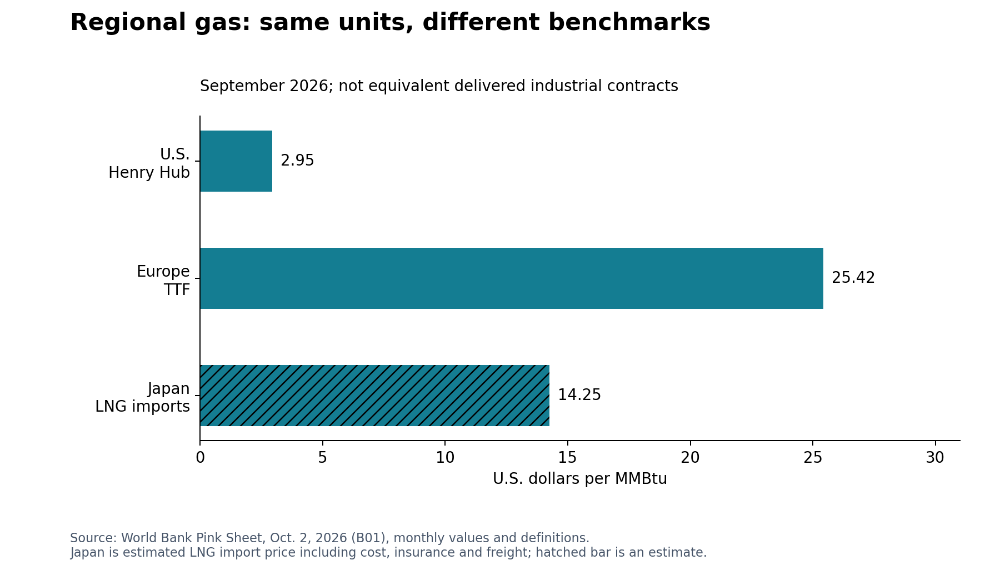
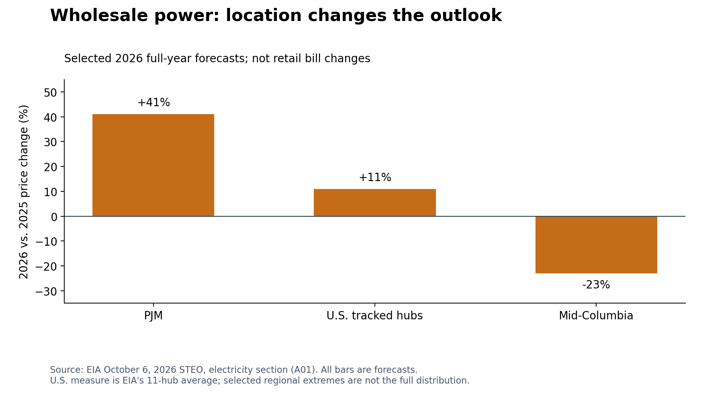
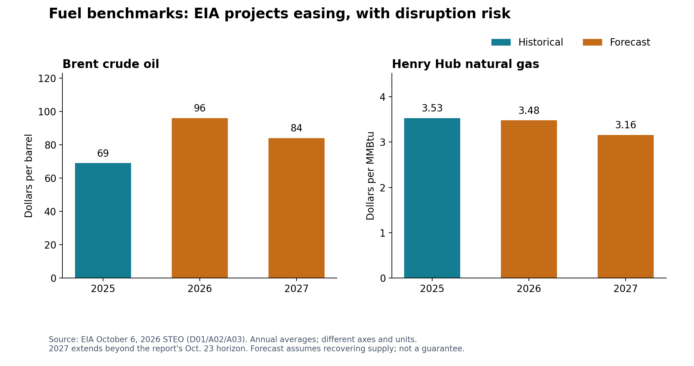
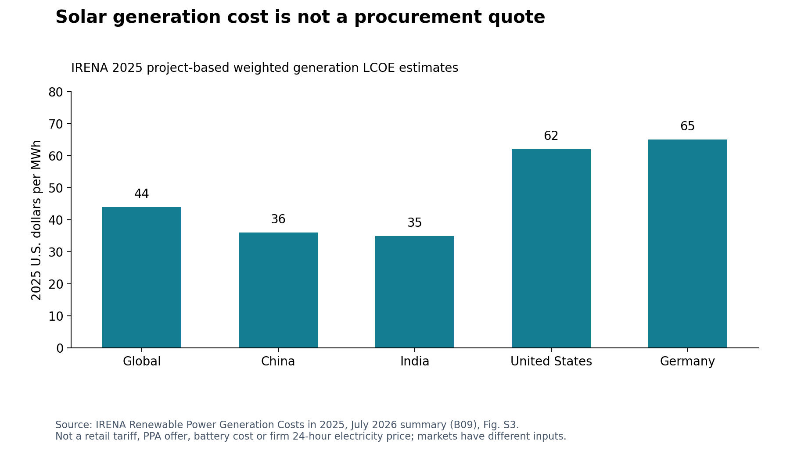

# Energy supply chains: procurement outlook and decision brief

**Edition 2 — revised October 23, 2026.** Evidence cutoff: **October 23, 2026**. Decision horizon: **October 23, 2026–October 23, 2027**. Both the global market and the implications for U.S. companies are considered throughout. This is a reviewed research draft for the planned website; it has not been published.

## 1. Decisions to make now

**Buy deliverability and contractual certainty alongside equipment and energy.** A global supply surplus, cheaper battery hardware, or lower national fuel benchmark does not establish a low-risk delivered price at a particular facility.

| Decision | Global perspective | U.S. company/procurement perspective | Conditional 12-month outlook; confidence |
|---|---|---|---|
| Energy purchasing | Regional gas and power markets remain different; fuel-importing suppliers face different exposures | Buy against local tariffs, basis, demand/capacity charges and actual load | Regional divergence remains commercially important; **medium** [B01] [A01] [A02] |
| Grid and equipment slots | Generation investment alone cannot guarantee usable network capacity | Verify utility connection milestones, equipment slots and commissioning before committing capital | U.S. connection and execution constraints persist unevenly; **medium** [B03] [S09] [B05] |
| Fuel and logistics | Product availability, freight and insurance can remain stressed after crude flows improve | Audit diesel surcharges and alternate terminals, carriers and backup supply | Volatility persists; normalization timing uncertain; **medium / low on timing** [A03] [A04] [A05] |
| Renewables and batteries | Global project costs, hardware prices and dispatch economics differ | Compare qualified, landed and commissioned cost, with and without credits | More buying options, but uneven savings and delivery; **medium** [B06] [B07] [B09] [B12] |
| Critical minerals | Adequate aggregate supply can coexist with concentrated refining and license risk | Trace processors and component inputs, not just the final assembler | Restrictions and supplier concentration remain material; **medium** [A19] [B17] |
| Trade and regulatory exposure | Supplier diversification redirects trade but does not remove origin or trade-remedy risk | Recheck scope, producer, HTS classification, entry date and eligibility before orders | Compliance-driven sourcing fragmentation persists; **medium; future rule changes low** [B10] [B15] [B16] [A10] |

**Priority actions:** map exposed facilities and suppliers in the first 30 days; confirm critical slots and contract risk allocation within 90 days; review the evidence every Tuesday and Thursday. These are analyst recommendations, not claims of universal savings or mandatory inventory levels.

## 2. How to read the evidence

- **Reported observation:** historical data or an estimate reproduced from an opened source. It is not automatically independently measured or final.
- **Documented provision:** text in an identified legal or regulatory document. Its existence is verified; transaction-specific applicability and subsequent changes still require checks.
- **Source forecast:** a named publisher's prediction, with its original date, assumptions and horizon retained.
- **Analyst outlook:** our conditional inference connecting evidence to a procurement decision. It is not a source's quoted forecast or an observed fact.
- **Scenario:** a possible outcome used for planning; no probability is implied.

**High confidence** means strong evidence for the specified observation or mechanism; **medium** means a plausible direction with important dependencies; **low** means event timing or direction is insufficiently supported. Ratings are qualitative, not calibrated probabilities. Confidence in a source's reported number is separate from confidence that its forecast will occur.

## 3. Energy prices and availability: purchase by region and cost component

**Reported observations — global.** The World Bank's **October 2, 2026 Pink Sheet** gives September natural gas benchmarks of **$2.95/MMBtu for U.S. Henry Hub**, **$25.42/MMBtu for European TTF**, and **$14.25/MMBtu for Japanese LNG imports**. Japan's recent monthly values are estimates. TTF and Henry Hub are market benchmarks; Japan is an import-price series including cost, insurance and freight. These are not equivalent delivered contracts or industrial electricity prices. [B01]

**Source forecast — U.S.** EIA's **October 6** outlook, with inputs finalized **October 1**, forecasts average wholesale power across its 11 hubs of **$52/MWh in 2026** and **$49/MWh in 2027**. It forecasts commercial and industrial electricity demand growing **2.8%** and **2.7%** respectively in 2027. Lower average wholesale prices can coexist with higher local capacity, distribution or transmission charges. These percentages are sector forecasts, not universal facility demand growth. [A01]

**Analyst outlook — next 12 months.** Suppliers in gas-importing regions remain vulnerable to a different price and availability mix from U.S. producers. U.S. buyers may benefit from domestic gas supply, but cold weather, local pipelines, grid charges and contract terms can dominate the national benchmark. EIA forecasts LNG exports rising to **18.6 Bcf/day in 2027** while Henry Hub averages **$3.16/MMBtu**, as production and inventories offset demand; export growth does not by itself prove rising U.S. gas prices. **Confidence: medium on direction; low-to-medium on exact prices.** [A02]

**Procurement decision.** Separate energy, basis, network/demand/capacity charges, fuel surcharge and tax components. Collect interval load and renewal dates; compare staggered fixed and indexed supply within company risk limits. Ask energy-intensive overseas suppliers which local benchmark, tariff and pass-through applies. Do not impose a European gas percentage change on a U.S. electricity bill. Reassess after weather, inventory, tariff or local service changes. [A01] [A02] [B01]

## 4. Grid availability and lead times: a queue is not a delivery promise

**Reported observation — U.S. generation connections.** Berkeley Lab's **2026 Queued Up** study (cataloged May; PDF dated June) covers about **98% of installed U.S. generating capacity** and reports **1,312 GW of generation and 749 GW of storage** in active queues at end-2025. For regions with data, the median request-to-commercial-operation time was **more than five years for projects completed in 2025**. Only **13% of capacity requested in 2000–2020** had reached operation by end-2025. These figures cover transmission-connected generation requests: **they exclude factory/data-center load requests, distribution connections and behind-the-meter projects**. Storage and generation are separate categories, not guaranteed future supply. [B03] [B04]

**Equipment evidence.** RMI's **May 8** analysis reports large power transformer waits of **up to four years**, specialized material and workforce constraints, and limited domestic production coverage of U.S. demand. An upper-end equipment quote is not the same statistic as Berkeley Lab's median completed-project interconnection timeline. Do not add the two durations mechanically. [S09]

**Forward planning context.** PJM's **July 14, 2026** release reports its **2028/2029 delivery-year** auction clearing at **$325/MW-day UCAP** and committed resources below its reliability requirement. That delivery year is **outside this report's horizon**. It is evidence of planning pressure, not a current $/MWh energy price, a forecast of 2027 bills, or proof that blackouts will occur. PJM explicitly says a shortfall does not necessarily mean load cannot be served reliably. Later interventions can change the position. [B05]

**Analyst outlook.** Existing connections, qualified equipment and credible commissioning schedules are likely to remain valuable to U.S. expansions. Globally, reliance on common cable, steel, transformer and engineering capacity transmits demand across borders, but a U.S. queue statistic cannot establish a global five-year lead time. **Confidence: high in the documented historical constraints; medium in next-year persistence at an individual project.** [B03] [S09] [S02]

**Procurement decision.** Require written utility milestones, engineering-approved specifications, factory slot evidence, testing and acceptance dates. Qualify alternate factories and repair options; standardize where safe. Tie payments to verifiable work and document substitutions. Assess spares against outage loss and replacement time. Update when the utility, manufacturer or commissioning plan changes, not only when national capacity announcements appear.

## 5. Fuel logistics: manage the product and route, not only the oil benchmark

**Reported observations — global.** IEA's **October 21** shipping analysis reports Middle East Gulf-to-Asia crude freight above **$37/barrel** by mid-October, with disrupted routes and tanker substitution spreading pressure across vessel classes. This is a route-specific tanker cost, not a universal ocean freight surcharge. Its **October 14 Oil Market Report** finds strained distillate availability and depleted inventories. [A04] [A05]

**Forecast differences matter.** The World Bank's **April 28** forecast put 2026 Brent at **$86/barrel**, assuming the most acute disruptions ended in May and flows recovered. EIA's newer **October 6** forecast puts 2026 Brent at **$96**, Q4 2026 at **$105**, and annual 2027 at **$84**, under different recovery assumptions. The April and October figures should not be averaged as a current consensus. The World Bank's October Pink Sheet reports September Brent at **$116.8**, while EIA's October oil discussion reports **$114**: source series/methodologies differ, so retain labels and do not manufacture a single reconciled observation. [B02] [B01] [A03]

**Analyst outlook.** Fuel normalization is conditional. IEA warns product-market tightness can persist into 2027 even as crude production recovers. U.S. trucking, agriculture, construction, backup generation and supplier transport face diesel/refining-margin and terminal risks. Overseas importers can face additional route, currency and financing pressure. U.S. production does not isolate buyers from globally traded product prices. **Confidence: high in observed disruption; medium in volatility persistence; low in its end date.** [A03] [A04] [A05]

**Procurement decision.** Make surcharge indices, base prices, reset dates and audit rights explicit. Verify terminals, alternative routes, insurance exclusions, fuel inventory location and continuity plans. Separate crude, diesel crack/basis and freight exposure. Avoid double counting a fuel rise through both direct purchases and carrier surcharges. Electrify suitable duty cycles where power and delivery are feasible; do not assume fleet or equipment replacement can eliminate disruption within 12 months.

## 6. Renewable and battery equipment: compare qualified installed performance

**Reported estimates — global versus U.S.** IRENA's **July 2026** cost report puts 2025 solar PV levelized generation cost at **$44/MWh globally**, **$36 in China**, **$35 in India**, **$62 in the U.S.**, and **$65 in Germany**, in **2025 dollars**. Its project-based weighted averages are not utility tariffs, PPA offers, firm 24-hour delivery prices or battery costs. [B09]

BloombergNEF's **February 18** public cost release reports a **$39/MWh fixed-axis solar benchmark** and **$78/MWh for a four-hour battery project** in 2025. These are modeled benchmarks with different samples and assumptions from IRENA. Battery storage's levelized $/MWh is also different from IRENA's **$140/kWh installed battery capital-cost** estimate. **Do not compare those figures as though they were the same product or add them without a project model.** [B06] [B09]

**New source forecast.** BloombergNEF's **October 22** storage outlook projects **188 GW / 535 GWh** of additions in 2026 and **209 GW / 638 GWh** in 2027. Earlier May reporting of BNEF projected **158 GW / 459 GWh** for 2026; Ember's August analysis used the older 459 GWh expectation. Forecast vintage and potentially coverage changed. The latest public BNEF projection is used as current context; the numbers are not measured deployment, independent confirmations, or a fully reconciled revision series. Annual 2027 extends beyond this report's October end date. [B07] [B14] [S06]

**Analyst outlook — global.** Broader storage deployment creates equipment, integration and service opportunities. Global component competition can coexist with weak supplier margins and poor project economics. **U.S. perspective:** tariffs, origin, tax-credit eligibility, local labor, interconnection and commissioning can prevent global hardware savings from reaching buyers. Market access, cycling, degradation and warranties determine usable flexibility. China-specific utilization estimates in the original sources are informative but not a U.S. investment return. **Confidence: medium on deployment opportunity and uneven delivered costs; low on universal battery payback.** [B07] [B12] [S07] [A10]

**Procurement decision.** Tender usable MW and MWh, efficiency, warranted throughput, augmentation, safety approvals, dispatch rights and long-term service. Compare like-for-like financing and credit assumptions. Separate PPA, equipment supply, EPC and build-transfer risks; Morgan Lewis's **March 13** contracting analysis explains how owners can retain gaps between separate contractors. Require clear handoffs, acceptance tests, serial-defect remedies, warranty security and support access. A framework agreement does not guarantee a supplier must accept a particular order. [B12]

## 7. Critical minerals and supplier concentration: buy continuity, not a shortage narrative

**Reported observations and scenarios.** IEA's **July 16** minerals outlook documents refining concentration, export restrictions and mineral-price rebounds, including effects from sulphur/sulphuric-acid disruption. BloombergNEF's **October 20** outlook finds refining concentration remains a concern while projecting sufficient long-run capacity for nine of ten assessed materials **if producers continue developing and replacing capacity**. BNEF expects a temporary lithium deficit to ease as capacity arrives in 2027, while IEA identifies longer-run supply gaps under its project-pipeline assumptions. Neither finding establishes that all minerals will be scarce—or cheap—over the next year. [A19] [B17]

BNEF's copper deficit begins in **2028** in its scenario; its **2050** deficit and investment figures are long-run context, **not a 2027 shortage forecast**. IEA's report says expanded Chinese rare-earth measures were suspended until **November 2026**. That is a dated watch item, not proof that they will resume unchanged or that subsequent arrangements do not exist. [B17] [A19]

**Analyst outlook — global.** Processing concentration, licenses and trade actions can interrupt supply despite adequate aggregate mining capacity. **U.S. perspective:** a domestic or allied-country assembler may still depend on the same refiner, graphite source, magnet producer or equipment technology as another bidder. Alternative chemistries can redistribute dependence rather than eliminate it. **Confidence: high in concentration as a mechanism; medium in ongoing exposure; low in the timing of particular restrictions.** [A19] [B17]

**Procurement decision.** Trace refiner, active material, magnet and critical subcomponent dependencies; distinguish two distributors from two independent supply chains. Qualify alternatives early, consider approved substitution/recycling and targeted stock buffers, and use material-index clauses with transparent definitions. Check supplier financial capacity, capacity reservations, insurance and service obligations: low prices alone do not establish a reliable warranty counterparty. No specific company failure is forecast.

## 8. Tariffs, trade rules and regulations: treat legal status as data

**Documented developments.** Commerce's **September 11** announcement covers final affirmative solar AD/CVD determinations for **India, Indonesia and Laos**. The **September 16** India CVD notice identifies a specific scope, producer treatment and cash-deposit/liquidation provisions. It conditions further actions on the ITC injury process. **A final Commerce determination is not interchangeable with a final duty order, a current cash-deposit instruction or every importer's final duty liability.** This review does not establish the subsequent injury/order status for a specific entry. [B16] [B10]

USTR's **September 2** notice amends four Section 301 product-exclusion descriptions to conform to HTS statistical changes effective **July 1, 2026**. It does not grant a blanket exclusion to batteries or all grid equipment. Proclamation 11001 (**January 14**, published **January 20**) directs negotiations on processed critical mineral imports and contemplates further remedies. It is not evidence by itself of a uniform new mineral tariff. [B15] [B11]

IRS Notice 2025-42 describes a **July 4, 2026 construction trigger** and a **December 31, 2027 wind/solar termination condition**; do not present the past construction trigger as a future opportunity or assign storage the same treatment automatically. IRS Notice 2026-15 and its **February 12** announcement address PFE/material-assistance restrictions for 45Y, 48E and 45X and anticipate additional guidance. Interim guidance is distinct from subsequent regulations. [A09] [A06] [A10]

**Analyst outlook.** Trade remedies, exclusions, origin rules and tax documentation are likely to continue segmenting global suppliers and U.S. landed costs. Country diversification alone does not remove product-scope or upstream eligibility exposure. Exact future rates, extensions and court outcomes are **low-confidence scenarios**, not report facts. [B10] [B15] [A10]

**Procurement decision.** Before accepting a quote, record product scope, HTS and Chapter 99 codes, producer/exporter, cell/component origin, applicable AD/CVD case, entry date, exclusions, tax assumptions and importer-of-record responsibility. Request broker/legal confirmation and the applicable current CBP instruction. Model no-credit, tariff-change and delayed-delivery cases. Allocate documented duties, change-in-law, customs delays and inaccurate origin statements in contracts. Domestic-content, customs-origin, forced-labor and PFE tests are different; passing one does not prove the others. [B12] [A10] [B15]

## 9. Procurement execution and update triggers

| Timing | Deliverable and owner | Evidence to obtain | Trigger for revision |
|---|---|---|---|
| First 30 days | Facilities + finance: exposure map | Site tariffs, load, fuel volumes, unhedged shares, outage loss | New rate, fuel, service or operating assumption |
| First 30 days | Projects: executable delivery plan | Utility milestones, factory slots, tested specifications, commissioning path | Date slip or failed acceptance milestone |
| Days 30–90 | Procurement + engineering: independent alternate sources | Upstream maps, qualified factory/processor, service and spares | Shared bottleneck, license issue, weakened supplier |
| Days 30–90 | Tax/trade + procurement: defensible landed-cost model | Current scope/rates/instructions, origin evidence, credit and no-credit cases | New rule/order, HTS change, supplier or entry-date change |
| Days 30–90 | Energy + operations: flexibility tender | Measured load, local rules, usable output, realistic lifecycle costs | Changed tariffs, cycling, efficiency or market rights |
| Every Tuesday and Thursday | Research editor + reviewer: evidence release | Checked sources, decision changes, unresolved gaps and source vintages | Publish a material change or a clearly labeled no-change review |

Use the [company exposure template](../data/company_exposure_template.csv) and delivered-price changes to estimate costs: unhedged MWh × $/MWh change; unhedged MMBtu × $/MMBtu change; and unhedged gallons × $/gallon change. Add demand/capacity, duties, transport and credit changes separately. Company inputs remain blank; no site-specific savings are asserted.

## 10. Evidence quality, open questions and website handoff

The revision adds World Bank, Berkeley Lab, PJM, BloombergNEF, IRENA, Commerce/USTR and specialist contract analysis to the original EIA/IEA/IRS, Ember, RMI and advisory material. The original nine articles remain in the [source assessment](../docs/source-notes.md); detailed legacy metrics are preserved in [edition 1](energy-supply-chain-outlook-2026-10-23-v1.md). The research favors dated primary material and retains relevant older structural/legal evidence with its age visible.

A press article repeating BNEF is the **same forecast family**, not independent corroboration. A PDF and its web chapter are one study. IRENA and BNEF use different cost methodologies; World Bank and EIA use different forecast vintages and price series; generation queues, transformer delivery and load connections are different measurements. These distinctions are retained rather than averaged away. No October 2026 World Bank outlook is assumed available merely because publication is normally twice yearly.

**Open verification:** site utility offers and supplier quotes; transaction-specific tariff/credit applicability; any later mineral-control suspension changes; and current ITC/CBP follow-through for the solar cases. Reuters remained inaccessible (401); IRENA's landing page returned 403 but its original executive-summary PDF was retrieved and read. No blocked article supports a finding. Proprietary BNEF material was limited to public releases, not assumed access to its full client data.

The [website plan](../docs/website-plan.md) defines pages, content contracts, implementation phases and acceptance criteria. The [twice-weekly playbook](../docs/twice-weekly-updates.md) defines the Tuesday/Thursday process, freshness rules, review and publication responsibilities. [Structured outlooks](../data/outlooks.json) preserve global and U.S. narratives separately. Draft outlooks are qualitative analyst inferences, not calibrated numeric forecasts. The website must never relabel source forecasts as verified outcomes, or a successful download as editorial verification. Website deployment and the automated update schedule remain unactivated.

[B01]: https://thedocs.worldbank.org/en/doc/74e8be41ceb20fa0da750cda2f6b9e4e-0050012026/related/CMO-Pink-Sheet-October-2026.pdf
[A01]: https://www.eia.gov/outlooks/steo/report/elec_coal_renew.php
[A02]: https://www.eia.gov/outlooks/steo/report/natgas.php
[B03]: https://emp.lbl.gov/publications/queued-2026-edition-characteristics
[S09]: https://rmi.org/resources/solving-the-gridlock-americas-electric-supply-chain-opportunity/
[B05]: https://www.pjm.com/-/media/DotCom/about-pjm/newsroom/2026-releases/20260714-pjm-capacity-auction-procures-138318-mw-of-generation-resources.pdf
[A03]: https://www.eia.gov/outlooks/steo/report/global_oil.php
[A04]: https://www.iea.org/commentaries/the-soaring-cost-of-shipping-is-lifting-the-price-of-oil-for-consumers
[A05]: https://www.iea.org/reports/oil-market-report-october-2026
[B06]: https://about.bnef.com/insights/clean-energy/battery-storage-costs-hit-record-lows-as-costs-of-other-clean-power-technologies-increased-bloombergnef/
[B07]: https://about.bnef.com/insights/commodities/energy-storage-growth-surge-goes-global-three-things-to-know/
[B09]: https://www.irena.org/-/media/Files/IRENA/Agency/Publication/2026/Jul/IRENA_TEC_RPGC_2025_Executive_summary_2026.pdf
[B12]: https://www.morganlewis.com/pubs/2026/03/utility-scale-energy-storage-procurements-in-2026-contracting-and-risk-allocation
[A19]: https://www.iea.org/reports/global-critical-minerals-outlook-2026/executive-summary
[B17]: https://about.bnef.com/insights/commodities/bloombergnefs-transition-metals-outlook-2026-global-metal-supply-shortages-set-to-ease-but-copper-faces-a-332-billion-investment-gap/
[B10]: https://www.federalregister.gov/documents/2026/09/16/2026-18947/crystalline-silicon-photovoltaic-cells-whether-or-not-assembled-into-modules-from-india-final
[B15]: https://www.federalregister.gov/documents/2026/09/02/2026-17925/notice-of-conforming-amendments-to-product-exclusions-chinas-acts-policies-and-practices-related-to
[B16]: https://www.trade.gov/final-affirmative-determinations-antidumping-duty-and-countervailing-duty-investigations-0
[A10]: https://www.irs.gov/pub/irs-drop/n-26-15.pdf
[B04]: https://emp.lbl.gov/sites/default/files/2026-06/Queued%20Up%202026%20Edition.pdf
[S02]: https://inverto.com/en/insights/energy-procurement-trends-challenges-2026/
[B02]: https://www.worldbank.org/en/news/press-release/2026/04/28/commodity-markets-outlook-april-2026-press-release
[B14]: https://www.energy-storage.news/bloombergnef-forecasts-158gw-of-global-energy-storage-deployments-in-2026/
[S06]: https://ember-energy.org/latest-insights/batteries-have-unlocked-the-era-of-anytime-solar/
[S07]: https://ember-energy.org/latest-insights/from-scale-to-system-navigating-the-next-phase-of-chinas-battery-storage/
[B11]: https://www.federalregister.gov/documents/2026/01/20/2026-01045/adjusting-imports-of-processed-critical-minerals-and-their-derivative-products-into-the-united
[A09]: https://www.irs.gov/pub/irs-drop/n-25-42.pdf
[A06]: https://www.irs.gov/newsroom/treasury-irs-provide-guidance-for-certain-energy-tax-credits-regarding-material-assistance-provided-by-prohibited-foreign-entities-under-the-one-big-beautiful-bill
